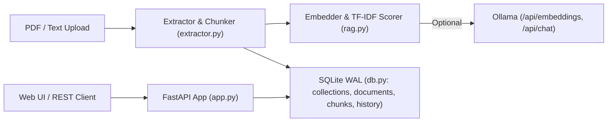

# DocuMind

Local document indexing, hybrid Ollama dense-vector / TF-IDF search, and source-cited RAG platform built with FastAPI, `pypdf`, and SQLite.

## Purpose & Problem Statement

Searching across local PDFs, runbooks, and engineering notes often requires uploading sensitive internal documents to external SaaS vector databases. DocuMind runs completely locally: it extracts text and page metadata from PDF and UTF-8 files, chunks and stores embeddings in SQLite, computes cosine similarity via Ollama embeddings (falling back seamlessly to built-in TF-IDF scoring when offline), and produces RAG answers with `[Source N]` citations.

## Features

- **PDF & Text Extraction**: Parses `.pdf` documents via `pypdf` (preserving title, author, and page numbers) alongside `.txt`, `.md`, `.py`, `.json`, `.yaml`, `.csv`, `.rst`, and `.log` files.
- **Hybrid Semantic & Lexical Search**: Generates dense vector embeddings via Ollama `/api/embeddings`, combines lexical + dense ranks with Reciprocal Rank Fusion (`mode="hybrid"`), and falls back automatically to deterministic TF-IDF cosine similarity offline.
- **Deduplication, Re-indexing & Batch CLI**: Skips identical uploads per collection using `content_sha256`, exposes chunk inspection (`GET /api/documents/{id}/chunks`) and re-embedding (`POST /api/documents/{id}/reindex`), and includes `documind-ingest` for recursive folder indexing.

## Quick Start

1. **Requirements**: Python 3.11+
2. **Clone**: `git clone https://github.com/fully-ai/documind.git && cd documind`
3. **Install**: `./scripts/install.sh` (Windows: `.\scripts\install.ps1`)
4. **Start**: `./scripts/dev.sh` (Windows: `.\scripts\dev.ps1`)
5. **Open**: `http://127.0.0.1:8092`
6. **Batch Ingest**: `.venv/bin/documind-ingest ./docs --collection runbooks`
7. **Run Tests**: `./scripts/test.sh` (Windows: `.\scripts\test.ps1`)
- **Grounded RAG with Citations**: Builds context-grounded prompts for Ollama `/api/chat` and returns `[Source N]` references with filename, page number, and score (plus extractive fallback when Ollama is offline).
- **Document Collections & Search History**: Organize indexed documents into collections, delete documents cleanly with cascading chunk cleanup, and audit recent queries.
- **Web UI & Docker Support**: Manage collections, index files, search, inspect RAG citations, and review query history from the browser interface.

## Tech Stack

- **Backend**: Python 3.11+, FastAPI, Uvicorn, HTTPX, aiosqlite, `pypdf`, Pydantic v2
- **Database**: SQLite in WAL mode
- **Local AI (Optional)**: Ollama (`nomic-embed-text` for embeddings, `llama3.2` for chat)

## System Requirements

- Python 3.11 or newer
- Optional local Ollama daemon for dense embeddings and LLM answer synthesis

## Installation

```bash
git clone https://github.com/fully-ai/documind.git
cd documind
python3 -m venv .venv
source .venv/bin/activate
pip install -e ".[dev]"
```

## Configuration

| Variable | Default | Description |
| --- | --- | --- |
| `DOCUMIND_HOST` | `127.0.0.1` | Bind address |
| `DOCUMIND_PORT` | `8092` | HTTP port |
| `DOCUMIND_DATA_DIR` | `./data` | SQLite database directory |
| `DOCUMIND_OLLAMA_BASE_URL` | `http://127.0.0.1:11434` | Ollama API base URL |
| `DOCUMIND_EMBED_MODEL` | `nomic-embed-text` | Embedding model name |
| `DOCUMIND_CHAT_MODEL` | `llama3.2` | Chat model name for RAG synthesis |
| `DOCUMIND_MAX_FILE_BYTES` | `20971520` | Max upload size (20 MiB) |
| `DOCUMIND_CHUNK_SIZE` | `700` | Characters per indexed chunk |
| `DOCUMIND_CHUNK_OVERLAP` | `100` | Character overlap between adjacent chunks |

## Running & Usage Examples

```bash
documind
```

Example API calls:

```bash
# Create a collection
curl -s -X POST http://127.0.0.1:8092/api/collections \
  -H 'Content-Type: application/json' \
  -d '{"name":"runbooks","description":"Infrastructure guides"}'

# Index a PDF document
curl -s -X POST http://127.0.0.1:8092/api/documents \
  -F "collection_id=default" -F "file=@architecture.pdf"

# Run RAG query
curl -s -X POST http://127.0.0.1:8092/api/rag \
  -H 'Content-Type: application/json' \
  -d '{"query":"How are backups scheduled?","top_k":4}'
```

## API Documentation

| Method & Path | Description |
| --- | --- |
| `GET /api/health` | Service health check |
| `GET /api/collections` / `POST /api/collections` | List or create document collections |
| `POST /api/documents` | Extract, chunk, optionally embed, and index a file |
| `GET /api/documents` / `DELETE /api/documents/{id}` | List or delete indexed documents |
| `POST /api/search` | Hybrid embedding / TF-IDF chunk search |
| `POST /api/rag` | Retrieve top chunks and synthesize cited RAG response |
| `GET /api/history` | List recent search and RAG queries |

## Architecture



## File Structure

```
documind/
├── src/documind/
│   ├── app.py            # FastAPI endpoints and ranking pipeline
│   ├── config.py         # Pydantic environment settings
│   ├── db.py             # Async SQLite repository
│   ├── extractor.py      # PDF/UTF-8 text extraction & chunking
│   ├── rag.py            # Ollama client + TF-IDF cosine similarity
│   ├── main.py           # CLI entrypoint
│   └── static/index.html # Browser workspace
├── tests/test_documind.py
├── docs/architecture.md
├── Dockerfile
└── compose.yaml
```

## Testing

```bash
ruff check src tests
mypy src
pytest -v
```

## Docker Deployment

```bash
docker compose up -d --build
```

## Security Notes

- Rejects binary NUL bytes in text files, unsupported file extensions, and payloads exceeding `DOCUMIND_MAX_FILE_BYTES`.
- Operates without external cloud calls; Ollama traffic stays local or on your Docker bridge network.

## Known Limitations

- Scanned image-only PDFs without embedded text layers cannot be parsed (OCR is not integrated).
- Vector cosine scoring scans chunks stored in SQLite linearly rather than using an approximate nearest-neighbor extension such as `sqlite-vec`.

## Contributing

See [CONTRIBUTING.md](CONTRIBUTING.md) and [CODE_OF_CONDUCT.md](CODE_OF_CONDUCT.md).

## License

Apache License 2.0 — see [LICENSE](LICENSE).
